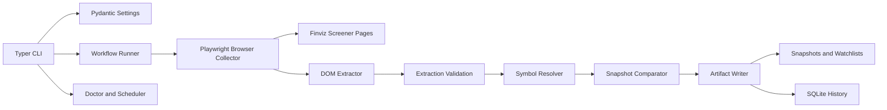

# CODEX_BUILD_REQUEST.md - Release Reconstruction for `finviz-weekly-scanner`

## 1. Document Control And Revision Status

**Document purpose:** Repository-grounded product, architecture, operating, and release-backlog specification.

**Revision date:** 2026-07-05

**Evidence used:** Current source tree, tests, package metadata, scripts, configuration examples, README, existing documentation, local diagnostic behavior, and recent working-tree diffs.

**Evidence hierarchy:** Verified runtime behavior and tests override source intent; source overrides scripts; scripts override examples and README; this document replaces the older one-screen build brief.

**Status vocabulary:**

- `IMPLEMENTED AND VERIFIED`: code exists and automated tests or local validation exercised it.
- `IMPLEMENTED BUT UNVERIFIED`: code exists, but no current verification was found.
- `PARTIALLY IMPLEMENTED`: code exists but behavior is incomplete or inconsistent.
- `KNOWN DEFECT`: behavior is wrong, unsafe, obsolete, or contradicts implemented workflows.
- `PLANNED`: required for release but not implemented.
- `DEPRECATED`: legacy behavior retained for compatibility.
- `OUT OF SCOPE`: intentionally excluded.

## 2. Executive Summary

`finviz-weekly-scanner` is a local Windows-oriented Python application that opens one or more configured Finviz screener URLs, extracts ticker rows with Playwright and DOM parsing, resolves exchanges from a local symbol master, compares each screen with its previous successful baseline, and writes TradingView-compatible watchlist files.

The application now supports multi-screen scans with one headed browser session and separate stable watchlist files under `watchlists\`. The original single-screen `saved_screen_url` configuration remains supported as a legacy compatibility path.

The project is not yet release-grade. The core offline workflow is well covered by tests, but several user-visible commands and operational paths lag behind the multi-screen implementation. Most importantly, `configure` still creates only legacy single-screen configuration, `validate` and `export-tradingview` still inspect the obsolete `latest` directory, scheduled execution requires a logged-in user to complete CAPTCHA challenges, and the local console script can break if the Python 3.12 virtual environment points to a missing interpreter. Scheduled execution avoids the console-script launcher by invoking the package through the virtual environment's Python interpreter.

## 3. Product Objective

The product objective is to provide a dependable personal watchlist-generation pipeline:

1. Run a saved Finviz screener, or multiple named screeners.
2. Extract all displayed symbols from all result pages.
3. Resolve each symbol to a TradingView exchange-qualified identifier.
4. Preserve immutable per-run snapshots and stable per-screen watchlists.
5. Compare each screen against that same screen's previous successful result.
6. Fail safely when extraction, validation, exchange resolution, or output publication is suspicious.

Current release posture: **PARTIALLY IMPLEMENTED**.

## 4. Scope

In scope:

- Windows local use.
- Python 3.12 package with Typer CLI.
- Playwright Chromium browser automation.
- Finviz screener DOM extraction.
- Multi-screen sequential scans.
- Local SQLite history.
- Local filesystem snapshots and TradingView `.txt` files.
- Windows Task Scheduler command generation and scripts.
- Symbol-master generation from Nasdaq Trader files.
- Offline tests.

Out of current reliable scope:

- Guaranteed unattended Finviz access.
- CAPTCHA solving or bypass.
- TradingView web upload automation.
- Email notification delivery.
- OCR fallback publication.
- Cloud synchronization.
- Brokerage or trading actions.

## 5. Non-Goals

- Do not bypass Finviz CAPTCHA, access challenges, rate limits, or anti-automation systems.
- Do not reverse engineer private Finviz or TradingView endpoints.
- Do not store browser cookies, credentials, or user secrets in SQLite or manifests.
- Do not silently guess exchanges for unknown tickers.
- Do not deduplicate symbols across different configured screens.
- Do not present scheduled unattended scans as dependable when Finviz may require human verification.

## 6. User Personas

- **Personal trader/investor:** wants TradingView-importable watchlists generated from repeatable Finviz screeners.
- **Operator/troubleshooter:** runs headed scans, solves Finviz verification manually when necessary, and inspects diagnostics.
- **Maintainer/developer:** updates selectors, fixes operational defects, and extends storage or output behavior.

## 7. Supported Workflows

### WF-1 Clean setup

Status: **PARTIALLY IMPLEMENTED**.

Lifecycle:

`installation -> configuration -> symbol-master placement or refresh -> doctor -> first headed scan -> stable watchlist import -> optional schedule`

Implementation evidence:

- `scripts\install.ps1` creates `.venv`, installs `.[dev]`, installs Chromium, then runs `finviz-scanner doctor`.
- `finviz-scanner configure` creates a legacy one-screen config only.
- `finviz-scanner refresh-symbol-master` downloads and validates Nasdaq Trader symbol data.

Known gap: install script assumes `py -3.12`; if Python 3.12 is absent or moved, generated entry points fail.

### WF-2 Single-screen scan

Status: **IMPLEMENTED AND VERIFIED**.

`finviz.saved_screen_url` is converted internally to screen `default`. `scan --headed` collects the screen, validates counts, resolves exchanges, writes a snapshot, updates SQLite, and writes `watchlists\default.txt`.

### WF-3 Multi-screen scan

Status: **IMPLEMENTED AND VERIFIED**.

`finviz.screens` supports multiple named screens. `scan --headed` processes all enabled screens sequentially in one browser context. Each successful screen publishes independently.

### WF-4 Scheduled scan

Status: **IMPLEMENTED AND VERIFIED**.

Task creation runs the scanner in headed mode under the logged-in user so Finviz human-verification challenges can be completed. The PowerShell wrapper invokes the package through the virtual environment's Python interpreter and returns the scanner's actual exit code to Task Scheduler. The workflow still requires user presence when Finviz presents a challenge.

## 8. System Context

External systems:

- Finviz public website: screener pages and dynamic DOM.
- Nasdaq Trader symbol directory: `nasdaqlisted.txt` and `otherlisted.txt`.
- TradingView: manual import of generated watchlist files.
- Windows Task Scheduler: optional weekly execution.
- Local filesystem: configuration, snapshots, diagnostics, SQLite, symbol master.
- Playwright Chromium: browser execution.

Security assumptions:

- User owns the configured Finviz URL.
- Runtime data stays on the user's machine unless the user syncs it externally.
- No credentials or cookies are required by the current code.

## 9. Architecture



Key architectural decision: browser collection is screen-source-specific, while validation, exchange resolution, comparison, and output generation are reusable watchlist pipeline components.

## 10. Component Responsibilities

- `src\finviz_scanner\cli.py`: CLI commands, command exit codes, user console output.
- `src\finviz_scanner\webapp.py`: loopback-only web control panel, background command execution, run history, and schedule status.
- `src\finviz_scanner\config.py`: YAML loading and Pydantic validation.
- `src\finviz_scanner\browser\finviz_browser.py`: Playwright lifecycle, navigation, pagination, screenshots, HTML capture.
- `src\finviz_scanner\browser\readiness.py`: Finviz readiness detection, CAPTCHA/challenge detection, diagnostics.
- `src\finviz_scanner\extraction\finviz_dom.py`: ticker-link parsing, total parsing, duplicate detection, blocker text detection.
- `src\finviz_scanner\symbols\resolver.py`: symbol-master CSV loading and exchange qualification.
- `src\finviz_scanner\symbols\master_builder.py`: Nasdaq Trader download, parsing, validation, atomic symbol-master refresh.
- `src\finviz_scanner\workflow\multi_screen_runner.py`: multi-screen orchestration, failure isolation, per-screen publication, manifest writing.
- `src\finviz_scanner\workflow\runner.py`: legacy single-screen workflow retained for tests/compatibility.
- `src\finviz_scanner\storage\sqlite.py`: run and membership persistence.
- `src\finviz_scanner\output\artifacts.py`: CSV, JSON, report, and TradingView text generation.
- `src\finviz_scanner\scheduler.py`: Windows Task Scheduler command construction.

## 11. CLI Contract

### `finviz-scanner configure`

Status: **PARTIALLY IMPLEMENTED**.

Syntax:

```powershell
finviz-scanner configure
```

Prompts for exact Finviz URL, output directory, weekly day, weekly time, OCR fallback, and email notification.

Reads: none required.

Writes: `%LOCALAPPDATA%\finviz-weekly-scanner\settings.yaml`.

Current behavior: writes `finviz.saved_screen_url`, not `finviz.screens`.

Known defect: no interactive way to configure multiple screens.

### `finviz-scanner scan`

Status: **IMPLEMENTED AND VERIFIED**.

Syntax:

```powershell
finviz-scanner scan [--headed] [--screen SCREEN_ID]... [--include-disabled]
```

Default behavior: loads config, scans all enabled screens, writes snapshots and stable watchlists.

Exit behavior:

- `0`: all selected screens succeeded.
- `1`: configuration error, all screens failed, or scanner error before safe publication.
- `2`: partial success.

Common failures: missing config, missing symbol master, Finviz challenge, selector breakage, count mismatch, unresolved symbol, browser launch failure.

### `finviz-scanner web`

Status: **IMPLEMENTED AND VERIFIED**.

Opens a local browser dashboard that runs visible scans and health checks without blocking the
interface, shows persisted screen-run outcomes, reports the Windows weekly-task state, and opens
the configured watchlist and log directories. It binds only to `127.0.0.1`, protects mutations
with a per-session token, and includes a double-click `web.bat` launcher.

Launch from File Explorer by double-clicking `web.bat` in the repository folder, or run
`.\web.bat` from PowerShell in that folder. The launcher opens the browser automatically.
The default port is 8765; if occupied, the current application starts on an available
loopback port and opens its actual address. After an update, use the newly opened tab to
avoid an older server. For visible startup diagnostics, run
`.\.venv\Scripts\python.exe -m finviz_scanner.cli web` and keep that terminal open.

### Local results review

The local dashboard also supports per-screen results review and session-only stock selection.
Its `GET /api/results?screen_id=<id>` endpoint reads the latest two successful screen runs in a
read-only SQLite transaction, checks membership against displayed/extracted counts, and returns
screen identity, latest attempt, successful run, baseline flag, and current/additions/removals/
unchanged symbol collections. Legacy records belong to `default`. Unknown screens return 404;
missing screen parameters return 400; configuration/database/integrity errors return 503;
no successful results returns 200 with empty collections.

The results table supports search, sorting, category filters, and selection of current symbols.
Copy selected and Download TXT export identical exchange-qualified comma-separated symbols in
Finviz rank order. Removed stocks are review-only. New successful results show Update results,
which explicitly resets selections. This adds no schema migration or snapshot publication changes.

### `finviz-scanner list-screens`

Status: **IMPLEMENTED AND VERIFIED**.

Syntax:

```powershell
finviz-scanner list-screens [--show-urls]
```

Default output hides URLs. `--show-urls` prints configured URLs.

### `finviz-scanner validate`

Status: **KNOWN DEFECT**.

Current behavior checks `latest\current.csv`, `latest\tradingview-current.txt`, and other legacy single-screen artifacts.

Conflict: multi-screen scans no longer maintain `latest`. This command must be redesigned for `snapshots\<run-id>\manifest.json` and per-screen directories.

### `finviz-scanner compare`

Status: **PARTIALLY IMPLEMENTED**.

Current behavior prints latest two successful rows from SQLite. It does not display additions/removals and is not screen-aware.

### `finviz-scanner export-tradingview`

Status: **KNOWN DEFECT**.

Current behavior calls legacy `validate` and reports that TradingView files are available in `latest`. It does not recreate multi-screen watchlists.

### `finviz-scanner history`

Status: **PARTIALLY IMPLEMENTED**.

Prints recent SQLite runs with start time, status, run ID, displayed count, and extracted count. It does not group by screen or show partial run summaries.

### `finviz-scanner doctor`

Status: **IMPLEMENTED AND VERIFIED**.

Checks Python version display, config loading, Playwright import, Chromium executable, output directory writability, SQLite creation, symbol-master existence/validity, usable row count, and blank ticker/exchange values.

Known defect: write-permission probe raises an unhandled `PermissionError` under restricted filesystem conditions instead of returning a concise diagnostic.

### `finviz-scanner refresh-symbol-master`

Status: **IMPLEMENTED AND VERIFIED**.

Downloads Nasdaq Trader source files, builds a temporary symbol master, validates it, atomically replaces `symbol-master.csv`, and reports loaded/skipped/duplicated/invalid counts.

### `finviz-scanner install-schedule`

Status: **IMPLEMENTED BUT UNVERIFIED**.

Creates/replaces a Windows task using `schtasks /Create`. Uses configured day/time.

### `finviz-scanner remove-schedule`

Status: **IMPLEMENTED BUT UNVERIFIED**.

Deletes task `FinvizWeeklyScanner`.

## 12. Configuration Contract

Configuration file:

```text
%LOCALAPPDATA%\finviz-weekly-scanner\settings.yaml
```

Main model: `Settings`.

Required top-level section: `finviz`.

Supported Finviz forms:

```yaml
finviz:
  saved_screen_url: "https://finviz.com/screener?..."
```

or:

```yaml
finviz:
  screens:
    - id: stage-2
      name: Stage 2 Candidates
      url: "https://finviz.com/screener?..."
      enabled: true
      tradingview_filename: "stage-2.txt"
  delay_between_screens_ms: 1000
```

Rules:

- If `screens` is present, `saved_screen_url` must not be present.
- If neither is present, configuration is invalid.
- URLs must use HTTPS, host `finviz.com` or `www.finviz.com`, path `/screener` or `/screener.ashx`, and not contain placeholder markers.
- Output root defaults to `Path.cwd() / "Documents" / "FinvizWeeklyScanner"` at runtime, not a fixed user path.

## 13. Screen-Definition Contract

Status: **IMPLEMENTED AND VERIFIED**.

Each configured screen requires:

- `id`: stable identifier.
- `name`: human-readable name.
- `url`: Finviz screener URL.
- `enabled`: optional, defaults to `true`.
- `tradingview_filename`: optional basename; defaults to `<screen-id>.txt`.

ID validation:

```text
^[a-z0-9][a-z0-9_-]{0,49}$
```

IDs are case-insensitively unique. Output filenames are case-insensitively unique and must be basenames only.

Execution order is configuration order. Requested screens are filtered but still processed in configuration order.

Disabled screens are skipped unless explicitly requested with `--include-disabled`.

## 14. Finviz Integration

Status: **PARTIALLY IMPLEMENTED**.

Navigation:

- `page.goto(url, wait_until="domcontentloaded", timeout=60000)`.
- Does not use `networkidle`.
- Validates final hostname is Finviz.
- Logs navigation start, DOM content loaded, status, final URL, and title.

Readiness:

- Primary selectors:
  - `td[data-boxover-ticker] a.tab-link[href^="stock?t="]`
  - `td[data-boxover-ticker] a.tab-link`
  - `a[href*="quote.ashx?t="]`
- Readiness succeeds when ticker links are detected.
- Blocker text such as CAPTCHA, unusual traffic, challenge, rate limit, "Just a moment", security verification, and "not a bot" raises `CaptchaError`.

Known limitation: legitimate zero-result screens are recognized but currently fail with `ExtractionError("Finviz explicitly reported zero results.")`. Release requirements must decide whether zero-result screens should publish empty watchlists.

## 15. Browser Automation

Status: **IMPLEMENTED AND VERIFIED for headed and offline mocked paths; headless live reliability is limited**.

Playwright behavior:

- Launches Chromium with `headless=not headed`.
- Creates one browser context and one page for `collect_many`.
- Reuses the page sequentially for all screens.
- Saves screenshots to `working\screenshots\<screen-id>\page-NN.png`.
- Saves HTML to `working\html\<screen-id>\page-NN.html`.
- Handles current page-select pagination and legacy "Next" pagination.
- Detects repeated page signatures.

Diagnostics on readiness failure:

- `failure-page.png`
- `failure-page.html`
- `failure-metadata.json`

Unattended automation is **not dependable** when Finviz presents human verification. Headed mode allows the user to complete verification manually; headless mode cannot.

## 16. Symbol Normalization

Status: **IMPLEMENTED AND VERIFIED**.

Symbol master location:

```text
<output.root_directory>\symbol-master.csv
```

Required headers exactly after normalization:

```text
ticker,exchange
```

CSV handling:

- Opens with `encoding="utf-8-sig"` for BOM safety.
- Normalizes headers by stripping whitespace and lowercasing.
- Rejects missing or extra headers with `SymbolMasterValidationError`.
- Tracks blank ticker/exchange rows for doctor validation.

Ticker normalization:

- Uppercases.
- Converts `/` to `.`.
- Removes whitespace.
- Accepts `[A-Z0-9][A-Z0-9.-]{0,14}`.
- Does not accept `=` or `+`.

Exchange mapping:

- `Q`, `NASDAQ` -> `NASDAQ`
- `N`, `NYSE` -> `NYSE`
- `A`, `AMEX` -> `AMEX`
- `P` -> `AMEX`
- `Z`, `BATS` -> `BATS`

Unknown extracted tickers raise `ExchangeResolutionError` and prevent publication.

## 17. Persistence Model

Status: **PARTIALLY IMPLEMENTED**.

SQLite database:

```text
<output.root_directory>\scanner.sqlite3
```

Tables:

- `runs`: run metadata, status, counts, error summary, optional `screen_id`.
- `screen_membership`: legacy global membership.
- `screen_symbol_membership`: multi-screen membership keyed by `(run_id, screen_id, ticker)`.

Multi-screen run IDs are stored as `<run-id>:<screen-id>` in SQLite. Filesystem snapshots use root `<run-id>` plus screen subdirectories.

Known gaps:

- No explicit database transaction spanning file publication and SQLite update.
- Failed screen records are stored, but failed data is not a comparison baseline.
- No retention cleanup policy.
- `first_seen`, `last_seen`, re-entry, and consecutive-week fields exist but are not fully computed.

## 18. Successful-Run Semantics

For a screen to be successful:

1. Finviz pages are collected.
2. Blockers are absent.
3. Displayed total is parsed.
4. Extracted unique ticker count equals displayed total when exact validation is enabled.
5. All extracted tickers resolve to known exchanges.
6. Outputs are written.
7. Stable watchlist is atomically replaced.
8. SQLite run status is `SUCCESS`.

Failed screens must not replace stable watchlist files and must not become comparison baselines.

Multi-screen run status:

- `success`: every selected screen succeeded.
- `partial_success`: at least one screen succeeded and at least one failed or was not attempted.
- `failed`: no selected screen succeeded.

## 19. Snapshot Comparison

Status: **IMPLEMENTED AND VERIFIED**.

Algorithm:

```text
current_by_ticker = current symbols keyed by normalized ticker
previous_by_ticker = previous symbols keyed by normalized ticker
additions = sorted(current - previous)
removals = sorted(previous - current)
unchanged = sorted(current intersection previous)
```

First successful screen run is baseline:

- `additions=()`
- `removals=()`
- `unchanged=()`
- `is_baseline=True`

Multi-screen comparison is isolated by `screen_id`.

## 20. Output-File Contracts

Per-screen snapshot directory:

```text
<root>\snapshots\<run-id>\<screen-id>\
```

Files written for each successful screen:

- `current.csv`
- `additions.csv`
- `removals.csv`
- `unchanged.csv`
- `current.json`
- `tradingview-current.txt`
- `tradingview-additions.txt`
- `tradingview-watchlist.txt`
- `additions.txt`
- `removals.txt`
- `tickers.csv`
- `metadata.json`
- `report.md`
- `run.json`

Run manifest:

```text
<root>\snapshots\<run-id>\manifest.json
```

Stable TradingView directory:

```text
<root>\watchlists\
```

Stable files:

```text
<root>\watchlists\<screen-id>.txt
```

or configured `tradingview_filename`.

## 21. TradingView Integration

Status: **IMPLEMENTED AND VERIFIED for file generation; OUT OF SCOPE for automated upload**.

TradingView files are UTF-8 text containing one comma-separated line of exchange-qualified symbols, sorted by Finviz rank:

```text
NASDAQ:AAPL,NYSE:STT,NASDAQ:NVDA
```

The full stable watchlist for a screen is overwritten atomically on every successful scan of that screen. Historical full watchlists, additions, removals, CSVs, JSON, reports, and metadata remain in immutable snapshot directories.

Additions-only file behavior:

- Snapshot `tradingview-additions.txt` contains only additions.
- On baseline runs it includes a baseline note before an empty line.
- Multi-screen alias `additions.txt` contains only the comma-separated additions line and no baseline note.

Removals are retained in CSV and `removals.txt`; TradingView usually imports current or additions, not removals.

## 22. Logging And Diagnostics

Status: **PARTIALLY IMPLEMENTED**.

Implemented:

- Browser readiness logs with navigation and page-ready details.
- Screen ID included in many browser logs.
- Failure diagnostics HTML, PNG, and JSON.
- Secret redaction utility with tests.

Known gaps:

- No central structured logging configuration is enforced by CLI.
- Run ID is not consistently included in every log record.
- Failure diagnostics for multiple screen failures can overwrite root `working\failure-*` files.

## 23. Installation

Status: **PARTIALLY IMPLEMENTED**.

Clean Windows installation:

```powershell
py -3.12 --version
scripts\install.ps1
finviz-scanner configure
finviz-scanner refresh-symbol-master
finviz-scanner doctor
finviz-scanner scan --headed
```

Requirements:

- Python `>=3.12,<3.13`.
- `py -3.12` launcher available.
- Network access for pip, Playwright Chromium, Nasdaq Trader symbol refresh, and Finviz live scans.
- Writable output root.

Known environment defect observed locally: default `python` was 3.14.3 and `python -m pip install -e .` failed because the package requires `<3.13`; the existing `.venv\Scripts\finviz-scanner.exe` pointed at a missing Python 3.12 path. Recreate `.venv` with a valid Python 3.12 install.

## 24. Upgrade And Uninstall

Upgrade:

```powershell
py -3.12 -m venv .venv
.\.venv\Scripts\python.exe -m pip install --upgrade pip
.\.venv\Scripts\python.exe -m pip install -e ".[dev]"
.\.venv\Scripts\python.exe -m playwright install chromium
.\.venv\Scripts\finviz-scanner.exe doctor
```

Uninstall scheduled task:

```powershell
finviz-scanner remove-schedule
```

Manual cleanup:

- Delete `.venv` if removing local install.
- Delete `%LOCALAPPDATA%\finviz-weekly-scanner\settings.yaml` only if removing user config.
- Delete output root only if historical snapshots/watchlists are no longer needed.

## 25. Windows Task Scheduler

Status: **IMPLEMENTED AND VERIFIED**.

CLI scheduler uses:

```text
schtasks /Create /TN FinvizWeeklyScanner /SC WEEKLY /D <DAY> /ST <TIME> /TR <absolute powershell run_scan.ps1 command> /F
```

Script scheduler uses similar `schtasks` construction.

`scripts\run_scan.ps1`:

- Creates logs directory.
- Writes timestamped stdout/stderr logs.
- Resolves the configured log directory at runtime.
- Runs `.venv\Scripts\python.exe -m finviz_scanner.cli scan --headed`.
- Returns the scanner process exit code to Task Scheduler.

Limitations:

- CAPTCHA/human verification still requires the user to be present.
- The task runs interactively under the user who installs it.
- No preflight preventing schedule creation before first successful headed scan.

## 26. Error Taxonomy

Implemented exception classes:

- `ScannerError`
- `ConfigurationError`
- `SymbolMasterValidationError`
- `ExtractionError`
- `CaptchaError`
- `ValidationError`
- `ExchangeResolutionError`
- `StorageError`
- `LockError`

Release requirement: every CLI command should catch expected exceptions and return concise actionable messages without rich tracebacks. `doctor` currently violates this for filesystem permission errors.

## 27. Recovery Procedures

- Missing config: run `finviz-scanner configure`.
- Need multi-screen config: edit `%LOCALAPPDATA%\finviz-weekly-scanner\settings.yaml` manually until `configure` supports screens.
- Missing symbol master: run `finviz-scanner refresh-symbol-master`.
- Invalid symbol master headers: ensure CSV headers normalize exactly to `ticker,exchange`; BOM is supported.
- CAPTCHA/challenge: run `finviz-scanner scan --headed`, complete verification manually, then rerun.
- Selector failure: inspect `working\failure-page.html`, `failure-page.png`, and `failure-metadata.json`; update selectors and fixtures.
- Unresolved exchange: refresh symbol master; if still unresolved, investigate ticker syntax or source data.
- Broken `.venv`: reinstall Python 3.12 and recreate `.venv`.
- Permission denied on output root: choose a writable output root or fix ACLs.

## 28. Security And Privacy Considerations

Status: **PARTIALLY IMPLEMENTED**.

Implemented:

- Real config is user-local and not in repo.
- Manifest does not store cookies or full HTML.
- Secret redaction utility exists and is tested.
- `.gitignore` excludes runtime data.

Risks:

- Screenshots and HTML may contain user-visible page state.
- Logs may include URLs; Finviz screener URLs are not secrets but can reveal strategy.
- No credential store integration exists.
- Email provider settings are modeled but not implemented.

## 29. Performance And Scalability

Expected scale: 1-10 Finviz result pages per screen, tens to hundreds of symbols.

Implemented limits:

- Browser collector `max_pages=50`.
- Delay between screens defaults to 1000 ms.
- Screens are intentionally sequential.

No parallel scanning is planned for release because it increases challenge risk and complicates isolation.

## 30. Testing Strategy

Status: **IMPLEMENTED AND VERIFIED for offline suite**.

Tools:

- `pytest`
- `ruff`
- `mypy`
- sanitized fixtures
- mocked Playwright behavior

Current test areas:

- DOM extraction and pagination.
- Finviz readiness and diagnostics.
- Browser collector error conversion and multi-screen context reuse.
- Symbol-master BOM/header/refresh behavior.
- Storage and failure-baseline safety.
- TradingView output formatting.
- Multi-screen config, CLI, workflow, manifest, and history isolation.
- Scheduler command construction.
- Workflow retries and process lock.

Live Finviz tests are opt-in. Headed live validation has succeeded in a temporary two-screen run, but unattended headless validation is not dependable.

## 31. Acceptance Criteria

Release acceptance requires:

- `pytest` passes offline.
- `ruff check .` passes.
- `ruff format --check .` passes.
- `mypy src` passes.
- `finviz-scanner doctor` passes under the intended Python 3.12 environment.
- First headed scan succeeds using real config.
- At least two configured real screens succeed in one headed session.
- `validate`, `history`, `compare`, and `export-tradingview` are updated for multi-screen outputs.
- Scheduled-scan limitations are documented in user-facing docs.
- Failed screen never overwrites previous stable watchlist.
- Failed or partial runs never become comparison baselines.

## 32. Known Limitations

- Headless scans are experimental when Finviz challenges automation.
- Multi-screen config must currently be edited manually.
- Zero-result screens fail instead of publishing empty outputs.
- No automated TradingView upload.
- No email notification implementation.
- No retention policy for snapshots, working HTML, screenshots, or logs.
- No persistent browser profile support.
- No central log configuration enforcement.

## 33. Known Defects

- `DEF-001`: `configure` writes only `saved_screen_url`; it cannot create `finviz.screens`.
- `DEF-002`: `validate` checks obsolete `latest` artifacts and is incompatible with multi-screen scan outputs.
- `DEF-003`: `export-tradingview` depends on obsolete `validate`.
- `DEF-004`: `compare` and `history` are not screen-aware enough for multi-screen operations.
- `DEF-005`: `doctor` can emit an unhandled traceback on output-root permission errors.
- `DEF-007`: local editable install fails under Python 3.14 by design; scripts require Python 3.12.
- `DEF-008`: failure diagnostics can be overwritten by later screen failures in the same run.
- `DEF-009`: `notification` and `tradingview.automated_upload_enabled` config fields are not functional.
- `DEF-010`: `first_seen`, `last_seen`, `weeks_on_list`, and `reentry` fields are not fully maintained.

## 34. Planned Enhancements

- Multi-screen interactive `configure`.
- Screen-aware `validate`, `compare`, `history`, and `export-tradingview`.
- Persistent browser profile option for headed troubleshooting.
- Clear zero-result policy and implementation.
- Retention/cleanup command.
- Better structured logging with run ID and screen ID.
- Optional notification adapter.
- Packaged installer or robust environment bootstrap.

## 35. Release-Readiness Checklist

- [x] Offline tests pass.
- [x] Ruff passes.
- [x] Mypy passes.
- [x] Multi-screen scan implemented.
- [x] Stable per-screen watchlists implemented.
- [x] Per-screen history isolation implemented.
- [x] Symbol-master refresh implemented.
- [ ] Python 3.12 environment repaired and verified through `finviz-scanner.exe`.
- [ ] Multi-screen interactive configuration implemented.
- [ ] Screen-aware validate/export/history/compare implemented.
- [ ] Permission errors handled cleanly in `doctor`.
- [x] Scheduler runs headed, propagates scan failures, and documents CAPTCHA limitations.
- [ ] Real user config contains at least two screens for recurring workflow.

## 36. Requirements Traceability Matrix

| ID | Capability | Status | Implementation | Tests / evidence |
|---|---|---|---|---|
| FR-001 | Scan a Finviz screener | IMPLEMENTED AND VERIFIED | `browser\finviz_browser.py`, `workflow\multi_screen_runner.py` | `test_workflow.py`, live headed temp run |
| FR-002 | Scan multiple screens sequentially | IMPLEMENTED AND VERIFIED | `collect_many`, `run_multi_screen_scan` | `test_multi_screen_workflow.py`, `test_browser_collector.py` |
| FR-003 | Isolate screen failures | IMPLEMENTED AND VERIFIED | `ScreenCollection`, `ScreenScanResult` | `test_failed_screen_retains_previous_stable_file` |
| FR-004 | Support legacy `saved_screen_url` | IMPLEMENTED AND VERIFIED | `FinvizConfig.resolved_screens` | `test_saved_screen_url_becomes_default_screen` |
| CLI-001 | `scan --screen` repeatable | IMPLEMENTED AND VERIFIED | `cli.scan` | `test_scan_passes_repeatable_screen_options` |
| CLI-002 | `list-screens` | IMPLEMENTED AND VERIFIED | `cli.list_screens` | `test_multi_screen_cli.py` |
| CLI-003 | `validate` multi-screen | KNOWN DEFECT | `cli.validate` | No valid multi-screen test |
| CLI-004 | `export-tradingview` multi-screen | KNOWN DEFECT | `cli.export_tradingview` | No valid multi-screen test |
| CFG-001 | Validate screen IDs | IMPLEMENTED AND VERIFIED | `ScreenConfig.validate_id` | `test_multi_screen_config.py` |
| CFG-002 | Reject duplicate outputs | IMPLEMENTED AND VERIFIED | `FinvizConfig.validate_screen_configuration` | `test_duplicate_output_filenames_are_rejected` |
| FIN-001 | Avoid `networkidle` | IMPLEMENTED AND VERIFIED | `page.goto(...domcontentloaded...)` | `test_finviz_readiness.py` |
| FIN-002 | Detect CAPTCHA/challenge | IMPLEMENTED AND VERIFIED | `detect_blockers` | readiness tests |
| FIN-003 | Legitimate zero-result publish | PLANNED | none | Known limitation |
| DATA-001 | BOM-safe symbol-master CSV | IMPLEMENTED AND VERIFIED | `load_symbol_master` | `test_symbol_master.py` |
| DATA-002 | Nasdaq Trader refresh | IMPLEMENTED AND VERIFIED | `master_builder.py` | `test_symbol_master_refresh.py` |
| STATE-001 | Previous success per screen | IMPLEMENTED AND VERIFIED | `latest_successful_symbols_for_screen` | `test_history_comparison_is_screen_scoped` |
| STATE-002 | Failed runs not baselines | IMPLEMENTED AND VERIFIED | success-only queries | `test_failed_run_does_not_replace_previous_successful_snapshot` |
| OUT-001 | TradingView comma line | IMPLEMENTED AND VERIFIED | `tradingview_line` | `test_tradingview_output.py` |
| OUT-002 | Atomic stable watchlist replace | IMPLEMENTED AND VERIFIED | `os.replace` | multi-screen workflow tests |
| OPS-001 | Windows task command | IMPLEMENTED AND VERIFIED | `scheduler.py` | `test_cli_scheduler_logging.py` |
| OPS-002 | Doctor checks symbol master | IMPLEMENTED AND VERIFIED | `cli.doctor` | local doctor run |
| OPS-003 | Doctor handles permission errors | KNOWN DEFECT | none | observed sandbox traceback |
| SEC-001 | No cookies in manifest | IMPLEMENTED AND VERIFIED | manifest writer | `test_manifest_records_success_and_failure` |
| TEST-001 | Offline default test suite | IMPLEMENTED AND VERIFIED | `pyproject.toml` | `94 passed, 1 skipped` |

## 37. Open Decisions

- Should zero-result Finviz screens publish empty watchlists or fail to preserve prior output?
- Should the application create/update multi-screen config interactively, or should screen config remain manual YAML editing?
- Should `latest` be removed, restored as a compatibility alias, or replaced by per-screen `latest\<screen-id>` directories?
- Should browser sessions use a persistent user data directory?
- Should stable watchlists include a trailing newline?
- Should `P`/NYSE Arca map to `AMEX`, `NYSEARCA`, or a configurable TradingView prefix?

## Acceptance Scenarios

### AS-001 Clean Windows installation

Given Python 3.12 is installed and available as `py -3.12`, when the user runs `scripts\install.ps1`, then `.venv` is created, dependencies install, Chromium installs, and `doctor` runs.

### AS-002 Successful doctor execution

Given valid config, writable output root, installed Chromium, and a valid symbol master, when `finviz-scanner doctor` runs, then it exits `0` and reports usable symbol rows.

### AS-003 First successful headed scan

Given one configured screen and a valid symbol master, when `finviz-scanner scan --headed` succeeds, then a snapshot directory, manifest, SQLite success row, and stable watchlist are created.

### AS-004 Subsequent scan with additions

Given a previous successful screen run, when a later successful run contains new tickers, then additions files contain only new tickers.

### AS-005 Subsequent scan with removals

Given a previous successful screen run, when a later successful run omits previous tickers, then removals files contain only omitted tickers.

### AS-006 Scan with additions and removals

Given a previous successful screen run, when current and previous sets differ both ways, then additions, removals, and unchanged are calculated by normalized ticker.

### AS-007 Multi-screen scan

Given multiple enabled screens, when `scan --headed` runs, then one browser session processes screens in config order and writes separate outputs.

### AS-008 One screen fails while another succeeds

Given two screens, when one screen fails after another succeeds, then successful output is published and failed screen retains previous stable file.

### AS-009 CAPTCHA displayed

Given Finviz returns challenge text, when readiness inspects the page, then `CaptchaError` is raised and diagnostics are saved.

### AS-010 Finviz page times out

Given navigation times out before document readiness, when no result locator appears, then scan fails with a navigation timeout message and diagnostics.

### AS-011 Document loaded but selectors missing

Given a Finviz-looking page without ticker selectors or zero-result indicator, when readiness times out, then extraction fails without publication.

### AS-012 Empty legitimate screen result

Current behavior: fails. Release decision required before acceptance.

### AS-013 Browser launch failure

Given Chromium cannot launch, when scan starts, then the screen/run fails and previous outputs remain.

### AS-014 Missing symbol-master file

Given no `symbol-master.csv`, when scan starts, then `ConfigurationError` is raised before publication.

### AS-015 BOM-prefixed symbol-master header

Given a UTF-8 BOM CSV with `ticker,exchange`, when loaded, then headers normalize and rows load.

### AS-016 Quoted CSV header

Given normal CSV quoting around headers, when `csv.DictReader` loads it, then headers normalize to `ticker,exchange`.

### AS-017 Unknown ticker

Given extracted ticker absent from symbol master, when resolver runs, then `ExchangeResolutionError` prevents publication.

### AS-018 Failed run after prior successful run

Given a prior stable watchlist, when a later screen fails, then the stable watchlist remains unchanged.

### AS-019 TradingView full-watchlist generation

Given resolved symbols, when outputs are written, then full TradingView files contain one comma-separated exchange-qualified line.

### AS-020 Additions-only file generation

Given comparison additions, when outputs are written, then additions files contain only additions.

### AS-021 Removals-only file generation

Given comparison removals, when outputs are written, then removals CSV and alias text contain only removals.

### AS-022 Atomic replacement of output files

Given a successful screen, when stable watchlist is published, then a temporary file is replaced via `os.replace`.

### AS-023 Scheduled execution using an absolute runner path

Given settings and project root, when the scheduler command is generated, then it contains the absolute runner-script path and remains within the `schtasks` action-length limit. The runner derives the project root from its own location and loads the configured log directory at runtime.

### AS-024 Filesystem permission failure

Current behavior: `doctor` can traceback. Release requirement: catch and print actionable error.

### AS-025 Test execution on Windows

Given default temp permissions fail, when running tests, then use `python -m pytest --basetemp <writable-temp>`.
