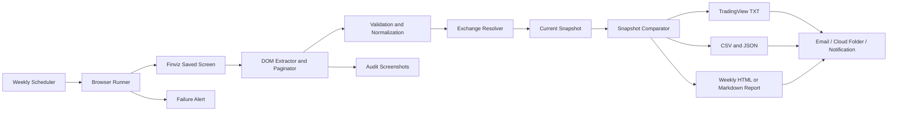

# Codex Build Request — Finviz Weekly Stage-2 Scanner

**Use this file as the complete implementation brief for Codex.**

Codex must read this entire file before creating or changing code. The product specification later in this document is authoritative. Where the implementation instructions and product specification differ, choose the safer behavior and document the decision.

---

## 1. Outcome required from Codex

Create a complete, locally runnable Windows application named `finviz-weekly-scanner` that:

1. Opens a configured Finviz screener URL once each week.
2. Collects every ticker from every results page.
3. Saves page screenshots for audit purposes.
4. Validates that the number of unique extracted tickers equals the result count displayed by Finviz.
5. Produces the complete current list in CSV, JSON, and TradingView watchlist formats.
6. Compares the current successful run with the previous successful run.
7. Produces separate lists of:
   - new additions,
   - names that dropped off,
   - unchanged names.
8. Treats the first successful run as the baseline and does not label the entire first list as new.
9. Refuses to publish a partial or suspicious result.
10. Runs unattended through Windows Task Scheduler after installation.

The application must generate both:

- a TradingView file for the complete current list, and
- a TradingView file containing only the new additions.

---

## 2. User environment and defaults

Build for the following default environment:

- Operating system: Windows 11
- Python: 3.12 or newer within the 3.12 series
- Timezone: `America/Denver`
- Weekly schedule: Saturday at 8:00 AM local time
- Browser automation: Playwright with Chromium
- Storage: SQLite plus dated files on the local filesystem
- Initial notification mode: local files and logs only
- Optional notification mode: email, disabled until configured
- TradingView upload: manual one-click import in version 1
- Finviz account type: free account

Do not hard-code a Windows username or machine-specific absolute path.

Use this default data location when the user does not choose another path:

```text
C:\01.My\02.Git\finviz-weekly-scanner\Documents\FinvizWeeklyScanner
```	

---

## 3. Required first-run experience

Implement an interactive configuration command:

```powershell
finviz-scanner configure
```

It must prompt the user for:

1. Exact Finviz screener URL.
2. Output directory, with the default shown above.
3. Weekly run day and time, defaulting to Saturday 8:00 AM.
4. Whether to enable OCR fallback, default `No`.
5. Whether to enable email notification, default `No`.

The command must validate that the Finviz URL:

- uses HTTPS,
- points to `finviz.com`,
- appears to be a screener URL,
- is not left as a placeholder.

Store the resulting non-secret configuration in a user-local YAML file. Never commit the user's real URL, email credentials, cookies, or browser profile.

Also generate:

- `config/settings.example.yaml`
- `.env.example`

Both must contain placeholders only.

---

## 4. Primary implementation decisions

### Extraction

Use direct DOM extraction as the primary method. Do not use screenshots or OCR as the primary extraction mechanism.

Save one full-page screenshot per Finviz result page regardless of whether extraction succeeds.

OCR may be implemented as an optional fallback, but it must be disabled by default. Any OCR-derived run must be clearly marked and must not publish outputs unless every symbol validates against the symbol master.

### Pagination

Finviz may display 20 companies on a page. The application must continue until all result pages are processed. It must protect against repeated-page loops and missing-page failures.

### Weekly comparison

Use only the latest prior run whose status is fully successful.

```text
new additions = current successful set - previous successful set
removed names = previous successful set - current successful set
unchanged     = intersection of both sets
```

A failed run, count-mismatched run, OCR-ambiguous run, or unresolved-exchange run must never become the comparison baseline.

### TradingView output

Generate comma-separated, exchange-qualified symbols, for example:

```text
NASDAQ:NVDA,NYSE:VRT,NASDAQ:APP
```

Generate these files after every successful non-baseline run:

```text
tradingview-current.txt
tradingview-additions.txt
current.csv
current.json
additions.csv
removals.csv
unchanged.csv
report.md
run.json
```

On the first successful baseline run, still generate the complete-current files. Generate an empty additions file with a clear baseline note rather than reporting all names as additions.

---

## 5. Repository Codex must create

Create a Git repository with at least the following structure. Codex may refine module names, but it must preserve separation of concerns.

```text
finviz-weekly-scanner/
├── AGENTS.md
├── README.md
├── LICENSE
├── pyproject.toml
├── .gitignore
├── .env.example
├── config/
│   ├── settings.example.yaml
│   └── logging.yaml
├── docs/
│   ├── PRODUCT_SPEC.md
│   ├── ARCHITECTURE.md
│   ├── OPERATIONS.md
│   ├── TROUBLESHOOTING.md
│   └── SECURITY.md
├── src/
│   └── finviz_scanner/
│       ├── __init__.py
│       ├── cli.py
│       ├── config.py
│       ├── models.py
│       ├── errors.py
│       ├── browser/
│       ├── extraction/
│       ├── symbols/
│       ├── storage/
│       ├── comparison/
│       ├── output/
│       └── workflow/
├── scripts/
│   ├── install.ps1
│   ├── run_scan.ps1
│   ├── verify_installation.ps1
│   ├── create_scheduled_task.ps1
│   └── remove_scheduled_task.ps1
├── tests/
│   ├── fixtures/
│   ├── test_extraction.py
│   ├── test_pagination.py
│   ├── test_validation.py
│   ├── test_weekly_diff.py
│   ├── test_tradingview_output.py
│   ├── test_storage.py
│   └── test_workflow.py
└── .github/
    └── workflows/
        └── test.yml
```

Runtime data, screenshots, browser profiles, configuration containing the real URL, logs, and the SQLite database must be excluded from Git.

---

## 6. Required CLI commands

Implement these commands with clear help text and actionable errors:

```powershell
finviz-scanner configure
finviz-scanner scan
finviz-scanner scan --headed
finviz-scanner validate
finviz-scanner compare
finviz-scanner export-tradingview
finviz-scanner history
finviz-scanner doctor
finviz-scanner install-schedule
finviz-scanner remove-schedule
```

Minimum behavior:

- `configure`: create or update user-local configuration.
- `scan`: perform the complete workflow.
- `scan --headed`: open a visible browser for troubleshooting.
- `validate`: validate the most recent run and generated artifacts.
- `compare`: compare two selected successful snapshots or default to the latest two.
- `export-tradingview`: recreate TradingView files from a successful snapshot.
- `history`: print recent run status and additions/removals counts.
- `doctor`: verify Python, config, Playwright, Chromium, filesystem permissions, SQLite, and scheduler prerequisites.
- `install-schedule`: create or update the weekly Windows scheduled task.
- `remove-schedule`: remove only the scheduled task created by this application.

---

## 7. Reliability and safety requirements

Codex must implement all of the following:

1. Exact count validation for result sets under 500 symbols.
2. No overwrite of a prior successful snapshot.
3. Atomic publication: write into a temporary run directory, validate everything, then mark and expose it as successful.
4. File lock or process lock to prevent overlapping runs.
5. Maximum three attempts for temporary browser/network failures with exponential backoff.
6. No retry for CAPTCHA, configuration, validation, or unresolved-symbol failures.
7. Detection of CAPTCHA, login challenge, access denial, unexpected empty table, and selector breakage.
8. No CAPTCHA bypass and no private endpoint reverse engineering.
9. Structured logs with a unique run ID.
10. Secret redaction in logs.
11. Preservation of HTML and screenshots on failure for diagnosis.
12. A nonzero process exit code on failure.
13. A readable failure summary explaining the next manual action.
14. UTC timestamps internally and the configured timezone for display and scheduling.

---

## 8. Exchange resolution requirements

TradingView output must use exchange-qualified symbols.

Design the exchange resolver behind an interface so it can be replaced later. Prefer authoritative US symbol-directory data and cache it locally. Tests must use fixed local fixtures, not live network calls.

Do not silently guess ambiguous exchange prefixes. Unresolved or ambiguous symbols must:

- appear in an exception report,
- prevent TradingView publication by default,
- leave the previous successful snapshot untouched.

Handle share classes and punctuation carefully. Provide tests for symbols containing dots or dashes and document any TradingView-specific normalization.

---

## 9. Database and history requirements

Use SQLite. Store at least:

- run ID,
- start and finish times,
- local scheduled date,
- status,
- source URL fingerprint,
- displayed result count,
- extracted unique count,
- page count,
- extraction mode,
- software version or Git commit,
- error category and summary,
- ticker membership for each successful run,
- first-seen date,
- last-seen date,
- consecutive weeks on screen,
- re-entry indicator where practical.

Do not store browser cookies or credentials in SQLite.

---

## 10. Tests Codex must implement and run

All normal tests must run offline. Use sanitized HTML fixtures.

At minimum, prove that:

1. A 44-result screen across three pages yields exactly 44 unique tickers.
2. Twenty rows on page one, twenty on page two, and four on page three are handled correctly.
3. Two identical successful runs produce zero additions and zero removals.
4. Two additions and one removal are calculated correctly.
5. The first successful run is treated as a baseline.
6. A partial page load is rejected.
7. A displayed-count mismatch is rejected.
8. A repeated-page loop is detected.
9. Duplicate rows do not create duplicate output, but are logged and validated according to policy.
10. An unresolved exchange prevents publication.
11. A failed run does not replace the previous successful snapshot.
12. TradingView output is one UTF-8 comma-separated line with qualified symbols.
13. The additions-only TradingView file contains only new additions.
14. A process lock prevents two concurrent runs.
15. Secrets and cookies are not printed in logs.
16. Windows scheduler command generation uses absolute paths and the configured schedule.

Include an optional live integration test that is disabled by default and clearly documented.

---

## 11. Engineering standards

Use:

- Python 3.12
- Playwright
- Typer
- Pydantic Settings or an equivalent strongly validated configuration approach
- SQLite through the Python standard library or a lightweight, well-justified persistence layer
- pytest
- Ruff
- mypy

Requirements:

- Fully typed public interfaces.
- `pathlib` for paths.
- Specific exception classes, not broad silent exception handling.
- Dependency injection where it materially improves testability.
- No unfinished TODO-only functions.
- No fake production implementation.
- No tests that merely assert `True`.
- No live Finviz dependency in unit tests.
- Minimal production dependencies.
- Clear comments only where behavior is not self-evident.

Required checks before Codex claims completion:

```powershell
pytest
ruff check .
ruff format --check .
mypy src
```

Codex must fix failures rather than merely report them.

---

## 12. Windows installation requirements

Create PowerShell scripts that:

1. Create an isolated virtual environment.
2. Install the package and dependencies.
3. Install Playwright Chromium.
4. Run `finviz-scanner doctor`.
5. Guide the user through `finviz-scanner configure`.
6. Run the first scan in headed mode.
7. Create the Windows scheduled task only after a successful first scan.

The scheduled task must:

- run Saturday at 8:00 AM by default,
- use the user-configured time,
- use absolute executable and working-directory paths,
- prevent overlapping instances,
- write timestamped stdout and stderr logs,
- run without an open terminal,
- not embed passwords or secrets in task arguments.

Document whether the user must be logged in, depending on the browser-profile approach selected.

---

## 13. Documentation Codex must provide

`README.md` must include beginner-friendly, exact steps for:

1. Installing Python if it is absent.
2. Running `scripts\install.ps1`.
3. Copying the exact Finviz screener URL.
4. Running the first headed scan.
5. Reviewing the current, additions, and removals files.
6. Importing `tradingview-current.txt` into TradingView.
7. Importing `tradingview-additions.txt` when the user wants only new names.
8. Installing and testing the weekly schedule.
9. Reading logs after a failure.
10. Updating selectors if Finviz changes its page structure.
11. Uninstalling the scheduled task.

Also provide architecture, operations, troubleshooting, and security documents.

Create a concise repository-root `AGENTS.md` containing project rules and required checks. Keep it below Codex's default instruction-size limit. Put the full product details in `docs/PRODUCT_SPEC.md`.

---

## 14. Codex execution procedure

Codex must follow this sequence:

1. Read this complete file.
2. Restate the implementation plan and assumptions.
3. Initialize Git if the directory is not already a repository.
4. Create `AGENTS.md` and copy the product portion of this document into `docs/PRODUCT_SPEC.md`.
5. Implement the offline core first: models, comparison, storage, output, validation, tests.
6. Implement browser collection and pagination second.
7. Implement Windows installation and scheduling third.
8. Run every required check.
9. Fix every failing check.
10. Run the application doctor command.
11. Do not claim the live scraper is verified unless a real headed scan succeeds on the user's machine.
12. At completion, provide:
    - files created,
    - commands executed,
    - test and lint results,
    - assumptions,
    - remaining manual configuration,
    - exact next commands for the user.

Do not stop after generating a skeleton. Build the working application and tests.

---

## 15. Initial command the user will send to Codex

The user will place this file in an empty project directory and send:

```text
Read CODEX_BUILD_REQUEST.md completely. Build the application described in it in this project directory. Work in stages, run all required tests and quality checks, fix failures, and do not claim completion until the offline acceptance tests pass. Do not ask me for the Finviz URL during code generation; implement the configure command so I can enter it after the application is built.
```

---

# Authoritative Product and Technical Specification

# Finviz Weekly Stage-2 Scanner — Product and Technical Specification

**Version:** 1.0  
**Purpose:** Automatically collect a saved Finviz screener result each week, generate a TradingView-importable watchlist, and report additions and removals compared with the prior week.

---

## 1. Executive decision

The application should **not use screenshot OCR as its primary extraction method**. It should open the saved Finviz screener in a browser and extract ticker rows from the page's HTML/DOM. Screenshot capture and OCR should be retained only as a fallback and audit artifact.

Reasons:

- DOM extraction is materially more accurate than OCR for short ticker symbols.
- OCR can confuse `O/0`, `I/1`, punctuation, share classes, and exchange labels.
- DOM extraction can reliably paginate through all result pages.
- Screenshots can still be stored to prove what the page displayed during each run.

For the most stable and supported implementation, use Finviz's paid export/API capability. A free-account/browser-automation implementation is feasible for a weekly personal workflow, but it remains dependent on page structure, login state, anti-bot controls, and Finviz's permitted-use rules.

---

## 2. Business objective

Every week, after the US market closes:

1. Open the configured Finviz Stage-2 screener.
2. Retrieve every matching company from all pages.
3. Normalize symbols and resolve the listing exchange.
4. Save a dated snapshot.
5. Compare it with the most recent successful prior snapshot.
6. Produce:
   - Current full list
   - New additions
   - Deletions / stocks falling off the screen
   - TradingView import file
   - Human-readable weekly report
7. Deliver the files and summary automatically.

---

## 3. Assumed screener filters

The screenshot appears to contain nine active filters. Store the saved Finviz screener URL as the source of truth rather than re-creating the filter parameters in code.

| Category | Filter | Assumed value |
|---|---|---|
| Descriptive | Market capitalization | Small or larger, likely over $300M |
| Descriptive | Average volume | Over 2M shares |
| Descriptive | Price | Over $30 |
| Technical | Quarterly performance | +20% or greater |
| Technical | 20-day SMA | SMA20 above SMA50 |
| Technical | 50-day SMA | SMA50 above SMA200 |
| Technical | 200-day SMA | Price above SMA200 |
| Technical | 52-week high/low | 0–10% below 52-week high |
| Technical | Average True Range | Over 2 |

**Configuration requirement:** The application must store the exact saved-screen URL copied from the browser after the filters are confirmed. This avoids ambiguity in truncated dropdown labels.

---

## 4. Scope

### In scope

- Weekly scheduled execution
- Finviz saved-screen navigation
- Multi-page extraction, including 20 rows per page
- Extraction of ticker and optional company metadata
- Exchange resolution
- Historical snapshots
- Add/remove comparison
- TradingView `.txt` output
- CSV and JSON output
- Email or local notification
- Run logs, screenshots, and failure alerts

### Out of scope for version 1

- Placing trades
- Automatically modifying brokerage accounts
- Fundamental analysis of candidates
- Buy/sell recommendations
- Intraday scanning
- Guaranteed unattended bypass of CAPTCHA, MFA, or site redesigns
- Unsupported direct calls to private Finviz or TradingView endpoints

---

## 5. Recommended architecture



---

## 6. Components

### 6.1 Scheduler

Run once each week after Friday's US market close.

Recommended default:

- Time zone: `America/Denver`
- Schedule: Saturday at 08:00 local time
- Retry: two retries, 15 minutes apart
- No duplicate successful run for the same ISO week

The schedule must be configurable.

### 6.2 Browser runner

Recommended technology: **Python + Playwright + Chromium**.

Responsibilities:

- Start a persistent browser profile.
- Load cookies/session state when necessary.
- Navigate to the exact configured saved-screen URL.
- Wait until result rows and the result count are visible.
- Dismiss harmless overlays only through stable selectors.
- Save one full-page screenshot per results page.
- Pass page content to the extractor.

Browser characteristics:

- Headed mode during installation and troubleshooting
- Headless mode for normal scheduled runs
- Fixed viewport and zoom for repeatability
- Realistic but slow request rate
- No concurrent page scraping

### 6.3 Finviz extractor

Primary method: parse the visible result table and ticker links from the DOM.

Required fields:

- `ticker`
- `company_name`, when displayed
- `finviz_rank`, when displayed
- `source_page`
- `source_url`
- `captured_at`

Optional fields:

- Sector
- Industry
- Country
- Market cap
- Price
- Volume
- Performance

Extraction rules:

1. Read the displayed total result count.
2. Extract every row on the current page.
3. Follow the visible **Next** control until it is disabled or absent.
4. Stop when:
   - no next page exists, or
   - all expected rows have been collected, or
   - a repeated page signature is detected.
5. De-duplicate by normalized ticker.
6. Validate that the extracted count equals the displayed total.
7. Mark the run as failed if the discrepancy exceeds the configured tolerance.

Default tolerance: zero missing rows for result sets under 500 symbols.

### 6.4 OCR fallback

OCR should run only when DOM extraction fails and screenshots were captured successfully.

Fallback process:

1. Crop the ticker column from each page screenshot.
2. Run OCR locally.
3. Normalize text to uppercase.
4. Match candidates against a current US-listed symbol directory.
5. Reject ambiguous or unmatched values.
6. Do not publish a TradingView file unless every OCR ticker passes validation.
7. Flag the run as `DEGRADED_OCR` in the report.

### 6.5 Exchange resolver

TradingView watchlists should use exchange-qualified symbols such as:

```text
NASDAQ:NVDA,NYSE:VRT,NASDAQ:APP
```

Resolve exchanges using an authoritative daily symbol master. Suggested inputs:

- Nasdaq-listed securities directory
- Other-exchange-listed securities directory

Canonical exchange mapping should be configurable, for example:

| Source code | TradingView prefix |
|---|---|
| Nasdaq-listed | `NASDAQ` |
| N / NYSE | `NYSE` |
| A / NYSE American | `AMEX` |
| P / NYSE Arca | `AMEX` or configured TradingView-compatible prefix |
| Z / Cboe | configured TradingView-compatible prefix |

Because TradingView symbol conventions may differ for some classes, ETFs, and special securities, unresolved symbols must be placed in an exception file rather than silently guessed.

### 6.6 Snapshot repository

Directory structure:

```text
data/
  snapshots/
    2026-07-04/
      finviz_raw.json
      normalized.csv
      tradingview.txt
      additions.csv
      removals.csv
      unchanged.csv
      report.md
      page-01.png
      page-02.png
      page-03.png
      run.json
  latest/
    normalized.csv
    tradingview.txt
    report.md
```

Storage options:

- Local directory for MVP
- OneDrive, Google Drive, Dropbox, S3, or Git repository for backup
- SQLite database for searchable history

### 6.7 Comparator

Let:

- `C` = current normalized symbol set
- `P` = previous successful normalized symbol set

Then:

```text
additions = C - P
removals  = P - C
unchanged = C ∩ P
```

The first successful run is a baseline. It should report every symbol as current but should not label all symbols as new additions unless explicitly configured.

Additional optional metrics:

- Weeks continuously on screen
- First-seen date
- Last-seen date
- Re-entry after prior removal
- Consecutive-week count
- Rank movement, if rank is available

### 6.8 Output generator

Generate the following artifacts after every successful run.

#### TradingView file

Filename:

```text
stage2_YYYY-MM-DD_tradingview.txt
```

Format:

```text
NASDAQ:NVDA,NYSE:VRT,NASDAQ:APP
```

Requirements:

- UTF-8 text
- One comma-separated line
- Exchange prefix included
- No duplicate symbols
- Deterministic sorting, preferably by Finviz order or alphabetically

#### CSV files

`current.csv`

```csv
ticker,exchange,tv_symbol,company_name,first_seen,last_seen,weeks_on_list,finviz_rank
NVDA,NASDAQ,NASDAQ:NVDA,NVIDIA Corp,2026-06-20,2026-07-04,3,1
```

`additions.csv` and `removals.csv` should use the same schema.

#### Weekly report

Example:

```text
Stage-2 Weekly Scan — 2026-07-04

Current matches: 44
New additions: 6
Fell off: 4
Unchanged: 38

New additions
- NASDAQ:ABCD
- NYSE:EFGH

Fell off
- NASDAQ:IJKL
- NYSE:MNOP

TradingView file: stage2_2026-07-04_tradingview.txt
Run status: SUCCESS
```

---

## 7. TradingView integration

### Supported baseline

The application generates a TradingView-compatible `.txt` watchlist. The user uploads it through TradingView's watchlist menu.

### Optional zero-touch adapter

A separate Playwright adapter may automate the TradingView web interface:

1. Open TradingView with a persistent logged-in profile.
2. Open the target watchlist menu.
3. Choose the upload-list action.
4. Upload the newly generated `.txt` file.
5. Confirm the resulting symbol count.
6. Save a screenshot.

This adapter must be feature-flagged and disabled by default because UI automation is brittle and may be affected by authentication, MFA, dialogs, plan restrictions, or interface changes.

Recommended default: automate everything through file creation and delivery, but keep TradingView import as a one-click manual action.

---

## 8. Functional requirements

### FR-1: Configurable screener source

The application shall accept the exact saved Finviz screener URL through configuration.

### FR-2: Complete pagination

The application shall retrieve all result pages until the total displayed count is satisfied.

### FR-3: Exact-count validation

The application shall compare the displayed result count with the number of unique extracted tickers.

### FR-4: Snapshot persistence

The application shall never overwrite a historical dated snapshot.

### FR-5: Weekly comparison

The application shall compare the current run only with the latest prior **successful** run.

### FR-6: TradingView output

The application shall generate a UTF-8 `.txt` file containing comma-separated, exchange-qualified TradingView symbols.

### FR-7: Additions and removals

The application shall generate separate lists for additions, removals, and unchanged symbols.

### FR-8: Notification

The application shall send a success summary with files or links after a valid run.

### FR-9: Failure notification

The application shall send an alert when extraction, count validation, exchange resolution, or file generation fails.

### FR-10: Audit evidence

The application shall store page screenshots, source URL, run time, row count, hashes, and software version.

---

## 9. Non-functional requirements

### Reliability

- Target successful scheduled run rate: 95% or higher, excluding third-party outages and CAPTCHA/MFA blocks.
- No report shall be published from a partial result set.
- Retries must be idempotent.

### Accuracy

- Ticker extraction precision: 100% for DOM mode.
- All TradingView symbols must resolve to a known exchange or be placed in exceptions.
- Zero silent symbol substitution.

### Performance

- Complete a 1–10 page screen in under five minutes under normal conditions.
- Rate-limit page changes to avoid aggressive access.

### Security

- Credentials and cookies must not be committed to source control.
- Use OS keychain, encrypted secret store, or protected environment variables.
- Restrict screenshots and logs to the user's machine or private storage.

### Maintainability

- Selectors must be isolated in one adapter module.
- Page-layout changes should require changes only to the Finviz adapter.
- Core comparison and output logic must be independent of Finviz.

### Observability

Each run must log:

- Start and finish time
- URL
- Browser version
- Page count
- Displayed result count
- Extracted result count
- Duplicate count
- Unresolved exchange count
- Additions/removals count
- Final status
- Error stack trace, when applicable

---

## 10. Configuration example

```yaml
app:
  name: finviz-stage2-weekly
  timezone: America/Denver

schedule:
  day: saturday
  time: "08:00"
  retries: 2
  retry_delay_minutes: 15

finviz:
  saved_screen_url: "COPY_EXACT_SAVED_SCREEN_URL_HERE"
  expected_page_size: 20
  browser_headless: true
  save_screenshots: true
  extraction_mode: dom
  allow_ocr_fallback: true

validation:
  require_exact_count: true
  fail_on_unresolved_exchange: true
  fail_on_duplicate_ticker: false

output:
  root_directory: ./data
  tradingview_sort: finviz_rank
  generate_csv: true
  generate_json: true
  generate_markdown_report: true

notification:
  provider: email
  recipients:
    - user@example.com
  attach_tradingview_file: true
  attach_report: true

tradingview:
  automated_upload_enabled: false
  target_watchlist_name: Stage 2 Weekly
```

---

## 11. Suggested data model

### `runs`

| Field | Type | Description |
|---|---|---|
| `run_id` | UUID | Unique run identifier |
| `scheduled_for` | datetime | Intended run time |
| `started_at` | datetime | Actual start |
| `finished_at` | datetime | Actual finish |
| `status` | enum | SUCCESS, FAILED, DEGRADED_OCR |
| `source_url` | text | Saved-screen URL |
| `displayed_count` | integer | Finviz result count |
| `extracted_count` | integer | Unique extracted count |
| `page_count` | integer | Pages processed |
| `error_message` | text | Failure summary |
| `software_version` | text | Git commit or package version |

### `screen_membership`

| Field | Type | Description |
|---|---|---|
| `run_id` | UUID | Parent run |
| `ticker` | text | Normalized ticker |
| `exchange` | text | Canonical exchange |
| `tv_symbol` | text | TradingView identifier |
| `company_name` | text | Company name |
| `finviz_rank` | integer | Display order |
| `source_page` | integer | Page number |
| `first_seen` | date | Earliest successful appearance |
| `last_seen` | date | Latest appearance |
| `consecutive_weeks` | integer | Consecutive membership count |

Primary key: `(run_id, ticker)`.

---

## 12. Processing algorithm

```python
def weekly_run(config):
    run = start_run()

    try:
        pages = open_finviz_and_capture_all_pages(config.finviz.saved_screen_url)
        displayed_total = pages.displayed_total

        raw_rows = extract_rows_from_dom(pages)
        rows = normalize_and_deduplicate(raw_rows)

        assert len(rows) == displayed_total

        symbol_master = load_current_us_symbol_master()
        rows = resolve_exchanges(rows, symbol_master)
        assert no_unresolved_symbols(rows)

        previous = load_latest_successful_snapshot()
        comparison = compare(previous, rows)

        artifacts = generate_outputs(rows, comparison)
        persist_snapshot(run, rows, comparison, artifacts, pages.screenshots)
        mark_success(run)
        send_success_notification(run, comparison, artifacts)

    except Exception as exc:
        mark_failed(run, exc)
        send_failure_notification(run, exc)
        raise
```

---

## 13. Failure and recovery behavior

| Failure | Required behavior |
|---|---|
| Finviz unavailable | Retry, then alert; preserve prior snapshot |
| CAPTCHA or login challenge | Stop and alert; do not attempt bypass |
| Result table selector missing | Save screenshot and HTML; fail run |
| Count mismatch | Retry once; fail if mismatch persists |
| Duplicate ticker | De-duplicate, log warning, preserve raw rows |
| Exchange unresolved | Put in exception file; fail publication by default |
| TradingView automation fails | Keep generated file; notify that manual upload is required |
| Notification fails | Keep artifacts and mark `SUCCESS_NOTIFICATION_FAILED` |
| Previous snapshot missing | Create baseline; no deletion calculation |

---

## 14. Acceptance criteria

The implementation is accepted when all conditions below pass.

1. Given a screen with 44 results across three pages, the application captures exactly 44 unique tickers.
2. The application saves all three page screenshots.
3. The generated TradingView file contains exactly 44 exchange-qualified symbols.
4. Re-running the same screen produces zero additions and zero removals.
5. Adding two symbols and removing one produces exactly two additions and one removal.
6. A partial two-page extraction against a displayed count of 44 is rejected.
7. An unresolved symbol prevents publication and appears in an exception report.
8. The first run creates a baseline without falsely reporting the full list as new.
9. A failed run does not replace the latest successful snapshot.
10. The weekly notification includes total, added, removed, unchanged, run status, and the TradingView file.

---

## 15. Testing strategy

### Unit tests

- Ticker normalization
- Share-class punctuation handling
- Set comparison
- Exchange mapping
- TradingView file formatting
- First-run baseline behavior

### Adapter tests

- One-page result set
- Three-page result set
- Empty result set
- Missing next button
- Repeated page loop
- Layout change / missing selector

### Golden-file tests

Store representative sanitized HTML pages and expected outputs. The extractor should be testable without live Finviz access.

### End-to-end test

Run in headed mode against the saved screen, compare the result count, inspect output files, then enable the scheduler.

---

## 16. Deployment options

### Option A — Windows desktop, recommended for the free-account workflow

- Python application
- Playwright Chromium
- Windows Task Scheduler
- Persistent local browser profile
- Local folders synchronized to OneDrive or Google Drive
- Email through an app password or approved mail API

Advantages:

- Browser looks like the user's normal machine
- Easy initial login and troubleshooting
- Lowest deployment complexity

### Option B — Small cloud VM

- Linux VM
- Cron or systemd timer
- Headless Chromium
- Private object storage
- Email/webhook notification

Risks:

- Higher probability of bot detection
- Session and CAPTCHA handling is less convenient

### Option C — Supported data route

- Finviz paid export/API
- Serverless function or scheduled Python job
- No browser or OCR
- Same normalization, comparison, and output modules

This is the cleanest option when reliability and zero-touch operation matter more than avoiding a subscription.

---

## 17. Recommended implementation phases

### Phase 1 — Reliable local MVP

- Exact saved-screen URL
- Playwright DOM extraction
- Multi-page capture
- CSV/JSON snapshots
- Add/remove report
- TradingView `.txt`
- Manual execution

### Phase 2 — Scheduling and delivery

- Windows Task Scheduler or cron
- Email/cloud-folder delivery
- Retry and failure alerts
- Historical SQLite database

### Phase 3 — Optional refinements

- Consecutive-week statistics
- Re-entry detection
- HTML dashboard
- TradingView UI automation
- OCR fallback
- Paid Finviz API adapter

---

## 18. Final recommendation

Build the core as a **source-independent weekly watchlist pipeline** with a Finviz adapter. Use DOM extraction, not OCR, for the free-account MVP. Generate a TradingView `.txt` file and weekly additions/removals report automatically. Keep TradingView upload manual unless there is a strong need for UI automation. For the most dependable zero-intervention workflow, use Finviz's supported export/API capability and eliminate browser scraping entirely.
